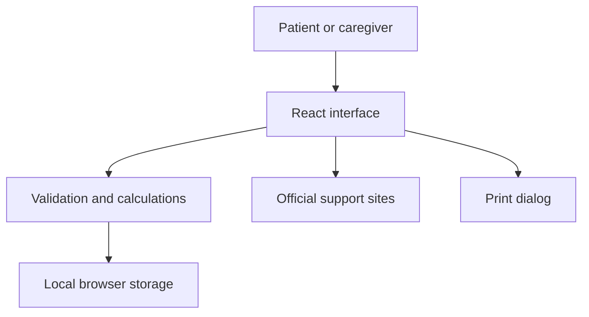

# Technical design

Harborstep is a React/Vite application served as static assets. There is no server-side account, database, or API integration. A user's visit logistics, tasks, and cost estimates are kept in browser local storage. Resource links navigate to the official third-party providers and print uses the browser's native print dialog.

## Trust boundaries

Local storage is unencrypted and scoped to the browser profile, not to an authenticated user. Clearing browser data deletes the plan and it cannot sync across devices. Users are instructed not to enter names, diagnoses, medical notes, or other sensitive information. No user information is intentionally sent to the resource providers by Harborstep; following a link is subject to that provider's own privacy policy.

The application is not designed for protected health information. Before introducing shared accounts or a backend, define consent, retention, recovery, authentication, authorization, abuse controls, monitoring, and operational ownership; test cross-user isolation and review applicable privacy requirements.

## Failure handling

Input validation keeps form values and identifies missing fields. A storage failure raises a visible message and offers printing. A curated provider link cannot guarantee funding, availability, or eligibility; the provider remains the authority.

## Verification

`npm test` checks domain behavior and `npm run build` produces static assets. Verify a clean install with a lockfile, browser flows, keyboard and mobile interactions, print output, and current provider links before release. The current implementation has not undergone a clinical study or formal security certification.
