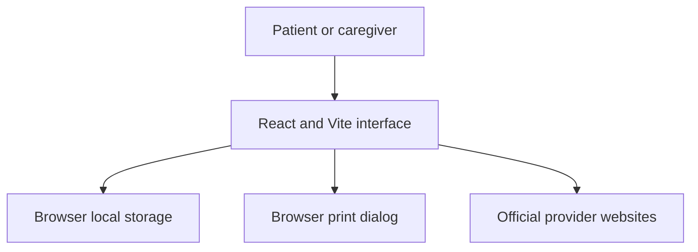

# Harborstep

Harborstep helps people affected by cancer plan the practical side of a U.S. care appointment: transportation, lodging, and potential costs. It connects a single appointment plan to relevant support organizations and helps the user keep their own next steps together.

**Live application:** https://harborstep.vercel.app/

## How it works

1. Add an appointment name, date, city, and state. Select the kinds of support needed.
2. Review links to established organizations. Confirm availability, funding, location, and eligibility directly with each provider.
3. Add, edit, complete, or remove next steps. Add or remove personal cost estimates.
4. Print the plan using the browser's print dialog. The user chooses whether to share it.

Plans are stored in the current browser's local storage, unencrypted. Clearing browser data deletes them; they do not sync between devices. Please do not enter names, diagnoses, treatment notes, contact details, or other sensitive information. A user can delete their plan using the in-app control.

Harborstep is an independent project. It does not book transport, reserve lodging, submit applications, assess eligibility, or provide medical advice. It is not affiliated with the organizations linked from the product. The initial resource list is U.S.-focused and not exhaustive. Programs and funding can change; provider pages remain authoritative.

## Run locally

Requires Node.js 20.19 or newer. Install dependencies with `npm install`, start with `npm run dev`, and open the displayed address. Build with `npm run build` and run the domain tests with `npm test`.

## Architecture

The app does not use a server or user account. Provider links lead to third-party sites under their own privacy policies. Do not use this version for medical data. Future authenticated syncing would require an independently reviewed threat model, consent, least-privilege authorization, data-retention rules, and production security testing.

## Source references

- [American Cancer Society: Road To Recovery](https://www.cancer.org/support-programs-and-services/road-to-recovery.html)
- [American Cancer Society: Hope Lodge](https://www.cancer.org/support-programs-and-services/patient-lodging/hope-lodge.html)
- [CancerCare financial assistance](https://www.cancercare.org/financial_assistance)
- [Triage Cancer](https://triagecancer.org/)

These pages were reviewed October 27, 2026. The product does not assert that these programs are available to any particular user or make claims about outcomes.

## Validation status

Automated domain tests cover required appointment inputs, filtering by chosen support needs, cost totals, and date display. Browser accessibility and end-to-end testing are still required. No patient outcome study or clinical validation has been conducted.

## License

MIT — see [LICENSE](LICENSE).
